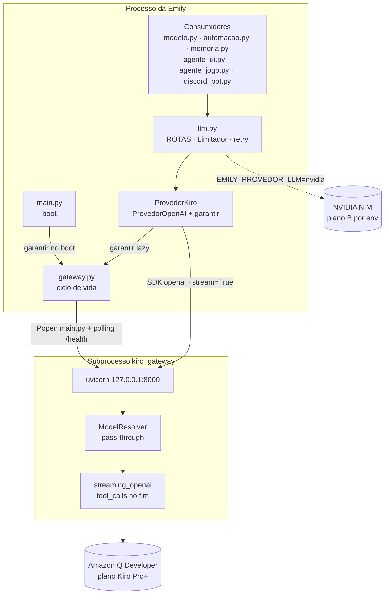
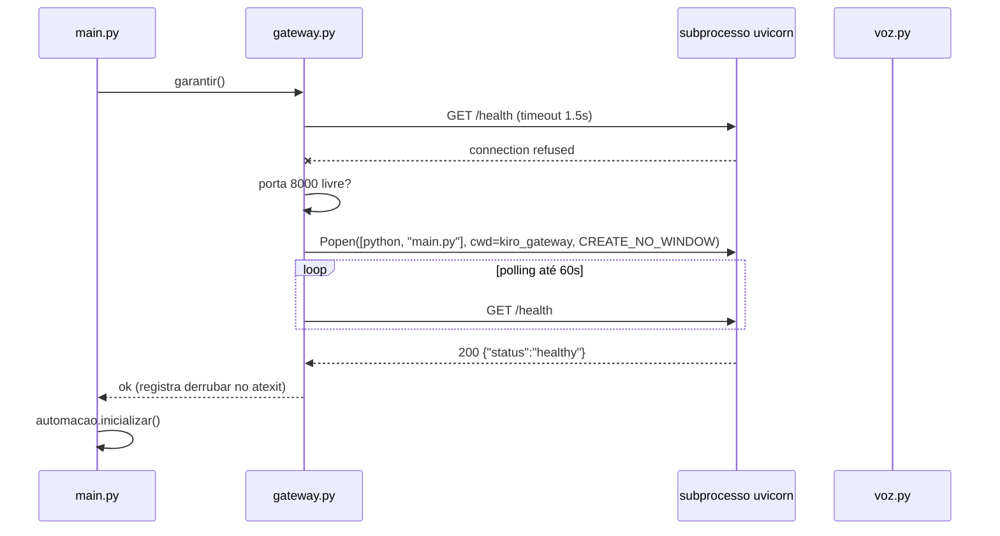
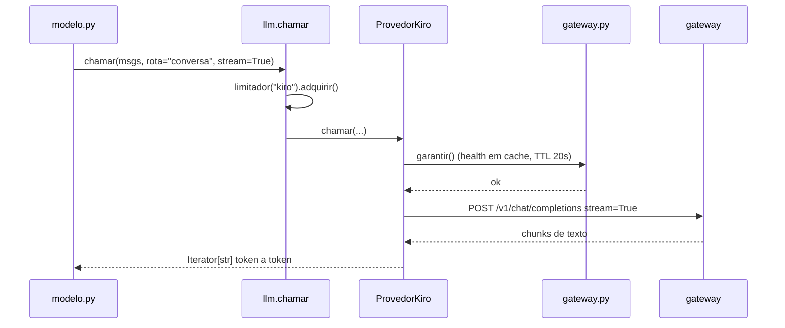
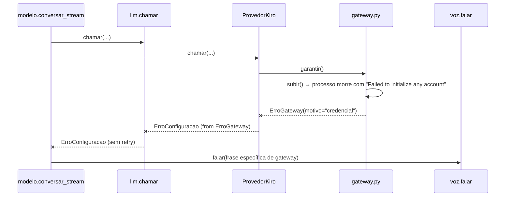

# Documento de Design: migracao-llm-kiro-gateway

## Visão Geral

Migrar todas as rotas de LLM da Emily do NVIDIA NIM para o **kiro-gateway** local (pasta `kiro_gateway/`), um proxy FastAPI OpenAI-compatible que expõe os modelos Claude do plano pago Kiro Pro+ do Vitor. A migração precisa preservar duas coisas que a Emily depende hoje: **streaming token a token** (a voz dela começa a falar antes da resposta terminar) e **tool calling** (o modelo decide qual ferramenta chamar).

O trabalho se divide em três frentes independentes:

1. **Uma entrada nova na tabela de provedores** do `llm.py` (`"kiro"` usando `ProvedorOpenAI` apontado para `http://127.0.0.1:8000/v1`) e a troca dos campos `provedor`/`modelo` das rotas. Nenhum consumidor (`modelo.py`, `automacao.py`, `memoria.py`, `agente_ui.py`, `agente_jogo.py`, `discord_bot.py`, `intencoes.py`, `ferramentas.py`) é tocado, porque todos passam pelo `llm.py`.
2. **Um módulo novo `gateway.py`** na raiz da Emily, responsável pelo ciclo de vida do proxy: verificar se está no ar, subir como subprocesso quando não está, e derrubar no fim — de forma idempotente e segura sob concorrência de threads.
3. **Uma chave de reversão** (`EMILY_PROVEDOR_LLM`) com duas tabelas de rotas paralelas, porque o Opus 5 é "experimental preview" e pode sair do ar sem aviso, como já aconteceu com os Qwen3.5 no NIM (410 Gone) e com o Opus 4.5 no free tier.

A migração não é um refactor: é edição de tabela mais um módulo de ciclo de vida. O `llm.py` foi escrito exatamente para esse caso.

## Fatos verificados no código (base do design)

Levantados por leitura direta do código antes de escrever este design. São premissas, não suposições:

- **Todo acesso a LLM passa por `llm.py`.** Nenhum SDK de LLM é instanciado fora dele. `modelo.py` é o único adaptador (`_chamar_llm`, `chamar_llm_simples`, funções de visão).
- **`emily-ai/` é cópia legada morta** (instancia `OpenAI`/`boto3` direto). Fora do escopo.
- **`llm.py` já tem tudo que a migração precisa**: `ProvedorOpenAI` genérico, `PROVEDORES`, tabela `ROTAS` com a dataclass `Rota`, `Limitador` token-bucket por provedor, retry com backoff em `chamar()`, aprendizado de `_params_rejeitados` e `diagnosticar()` rota por rota.
- **`ErroConfiguracao` não é repetido pelo retry** de `chamar()` (o `except ErroConfiguracao: raise` vem antes dos outros). É o canal certo para falha de gateway: falha rápido, sem quatro tentativas de 90s.
- **O gateway emite `tool_calls` em um único chunk no FIM do stream**, com os argumentos completos e `finish_reason="tool_calls"` (`kiro_gateway/kiro/streaming_openai.py` acumula `tool_calls_from_stream` e só monta o chunk depois de fechar o conteúdo). O NIM emitia em deltas incrementais. Consequência: em `FluxoComFerramentas`, a decisão antecipada (`_CHARS_PARA_DECIDIR = 80`) **nunca** dispara quando existe qualquer preâmbulo — o laço de `modelo.py` só encontra a ferramenta na releitura de `.chamadas` depois de esgotar `.texto()`. Isso funciona (o caso 5 de `_teste_laco.py` já cobre o ramo), mas passa a ser o caminho principal e não mais a exceção, então precisa de teste dedicado.
- **`ModelResolver` do gateway é pass-through** ("gateway, not gatekeeper"): normaliza o nome, consulta o cache dinâmico de `/ListAvailableModels` e, se não achar, repassa. `claude-opus-5` e `claude-sonnet-5` passam pelo padrão de família sem precisar de alias.
- **Endpoints do gateway**: `GET /` e `GET /health` (sem auth), `GET /v1/models` (com auth), `POST /v1/chat/completions`, `POST /v1/messages`.
- **`agente_jogo.py` usa `modelo.ROTA_AGENTE_UI`** (linha ~355, `max_tokens=2048`). Roda em laço durante gameplay, então não pode herdar o Opus 5 a 2.2x.
- **A Emily é empacotada com PyInstaller** (`Emily.spec`, `build_emily.py`). Em modo frozen, `sys.executable` é o `Emily.exe`, não um Python — não serve para `Popen`.
- **`kiro_gateway/requirements.txt`** pede `fastapi`, `uvicorn[standard]`, `httpx`, `loguru`, `python-dotenv`, `tiktoken`. O único cruzamento com o `requirements.txt` da Emily é `python-dotenv==1.2.2`, que já está lá.

## Arquitetura



Pontos de projeto que o diagrama mostra:

- `gateway.py` **não conhece** `llm.py`. A dependência é de mão única (`llm.py` importa `gateway` de forma lazy, dentro do método), então não existe ciclo de import e o `llm.py` continua importável se o `gateway.py` faltar.
- O caminho para o NIM continua existindo inteiro. A troca é de tabela, não de código.

## Diagramas de Sequência

### Boot da Emily (pagando o custo cedo)



### Chamada de LLM com o gateway já no ar



### Falha do gateway (sem fallback automático)



## Componentes e Interfaces

### 1. `gateway.py` (módulo novo, raiz da Emily)

**Propósito**: ser o único lugar que sabe que o LLM da Emily depende de um subprocesso local.

```python
# ── Constantes de configuração (todas com override por env) ──
URL_BASE: str          # EMILY_KIRO_URL, default "http://127.0.0.1:8000"
PASTA: Path            # raiz do projeto / "kiro_gateway"
TIMEOUT_HEALTH: float  # 1.5s — health é local, não precisa de paciência
TIMEOUT_BOOT: float    # EMILY_GATEWAY_TIMEOUT_BOOT, default 60.0
TTL_HEALTH: float      # 20.0s — janela em que confiamos no último health ok

# ── Motivos de falha (viram frase falada) ──
MOTIVO_PORTA_OCUPADA: str   # "porta_ocupada"
MOTIVO_NAO_SUBIU: str       # "nao_subiu"
MOTIVO_CREDENCIAL: str      # "credencial"
MOTIVO_SEM_PYTHON: str      # "sem_python"
MOTIVO_SEM_PASTA: str       # "sem_pasta"

class ErroGateway(RuntimeError):
    motivo: str
    detalhe: str
    def frase(self) -> str: ...      # PT-BR, pronta para o TTS

def esta_no_ar(timeout: float = TIMEOUT_HEALTH) -> bool: ...
def garantir() -> None: ...          # idempotente, thread-safe; levanta ErroGateway
def derrubar() -> None: ...          # só encerra o processo que NÓS subimos
def estado() -> dict: ...            # para diagnosticar(): no_ar, dono, pid, url
```

**Responsabilidades**:
- Detectar gateway já no ar (subido à mão pelo Vitor ou por outra instância da Emily) e nesse caso não subir nem derrubar nada.
- Subir o subprocesso com o interpretador correto, `cwd=kiro_gateway`, `CREATE_NO_WINDOW`, saída redirecionada para arquivo de log.
- Classificar a falha antes de levantar, lendo a cauda do log do subprocesso.
- Serializar chamadas concorrentes com `threading.RLock`, para que quatro threads da Emily não subam quatro uvicorns.
- Registrar `derrubar` em `atexit` uma única vez.

**Não é responsabilidade dele**: escolher modelo, montar requisição, decidir fallback.

### 2. `llm.py` — `ProvedorKiro`

**Propósito**: reaproveitar o `ProvedorOpenAI` inteiro e só acrescentar a garantia de que o gateway está no ar antes de falar com ele.

```python
class ProvedorKiro(ProvedorOpenAI):
    """
    ProvedorOpenAI + ciclo de vida do proxy local.

    Sobrescreve chamar() em vez de _obter_cliente() de propósito: o cliente é
    cacheado e só seria criado uma vez, então um gateway que morre no meio da
    sessão nunca seria religado. garantir() é barato (health em cache com TTL).
    """
    def chamar(self, **kw) -> RespostaLLM: ...
```

Tradução de erro: `ErroGateway` → `ErroConfiguracao(...) from erro`. Fica em `ErroConfiguracao` porque é a única classe que `chamar()` não repete — falha de gateway não melhora com backoff, e quatro tentativas de 300s de timeout deixariam a Emily muda por vinte minutos.

**Registro**:

```python
PROVEDORES["kiro"] = ProvedorKiro(
    nome="kiro",
    base_url=os.getenv("EMILY_KIRO_URL", "http://127.0.0.1:8000") + "/v1",
    env_chave="KIRO_PROXY_API_KEY",
    timeout=float(os.getenv("EMILY_KIRO_TIMEOUT", "300")),
)
```

O timeout sai de 90s para 300s porque as rotas de visão mandam imagem base64 e o Claude via Q Developer é mais lento que o nemotron. O `STREAMING_READ_TIMEOUT` default do gateway também é 300s, então os dois lados combinam.

O nome da variável na Emily é `KIRO_PROXY_API_KEY`, diferente do `PROXY_API_KEY` que o gateway lê. Isso é deliberado: evita que a variável da Emily vaze para o subprocesso e sobrescreva a configuração dele (ver "Isolamento de ambiente do subprocesso").

### 3. `llm.py` — duas tabelas de rotas

```python
PROVEDOR_ATIVO = os.getenv("EMILY_PROVEDOR_LLM", "kiro").strip().lower()

# Cada modelo em variável própria: Opus 5 é preview e pode sair do ar.
MODELO_KIRO_CONVERSA   = os.getenv("EMILY_KIRO_MODELO_CONVERSA",   "claude-sonnet-5")
MODELO_KIRO_BARATO     = os.getenv("EMILY_KIRO_MODELO_BARATO",     "claude-sonnet-5")
MODELO_KIRO_VISAO      = os.getenv("EMILY_KIRO_MODELO_VISAO",      "claude-sonnet-5")
MODELO_KIRO_AGENTE_UI  = os.getenv("EMILY_KIRO_MODELO_AGENTE_UI",  "claude-opus-5")
MODELO_KIRO_AGENTE_JOGO= os.getenv("EMILY_KIRO_MODELO_AGENTE_JOGO","claude-sonnet-5")

ROTAS_KIRO:   Dict[str, Rota] = { ... }   # 9 rotas
ROTAS_NVIDIA: Dict[str, Rota] = { ... }   # 9 rotas, as mesmas chaves

TABELAS = {"kiro": ROTAS_KIRO, "nvidia": ROTAS_NVIDIA}
ROTAS = TABELAS[PROVEDOR_ATIVO]           # ErroConfiguracao se o valor não existir
```

Divisão de modelos aprovada (multiplicadores de crédito conferidos no painel do Kiro):

| rota | modelo | multiplicador | por quê |
|---|---|---|---|
| `conversa` | `claude-sonnet-5` | 1.3x | fala com o Vitor, precisa de personalidade |
| `discord` | `claude-sonnet-5` | 1.3x | mesmo perfil, saída curta |
| `comando` | `claude-sonnet-5` | 1.3x | JSON estruturado |
| `extracao` | `claude-sonnet-5` | 1.3x | background, latência não importa |
| `visao` | `claude-sonnet-5` | 1.3x | descrição de tela |
| `agente_jogo` (**nova**) | `claude-sonnet-5` | 1.3x | laço de gameplay, não pode ser 2.2x |
| `agente_ui` | `claude-opus-5` | 2.2x | precisa apontar onde clicar |
| `classificador` | mais barato disponível | 1x–1.3x | SIM/NAO, `max_tokens=16` |
| `triagem_visual` | mais barato disponível | 1x–1.3x | SIM/NAO com imagem |

`classificador` e `triagem_visual` ficam **em aberto até a Task 1** confirmar o `/v1/models` da conta. Se Haiku 4.5 existir, é Haiku. Se não, a escolha é entre `auto` (1x, modelo imprevisível — aceitável para SIM/NAO) e `claude-sonnet-5` (1.3x, previsível). A decisão é registrada em `EMILY_KIRO_MODELO_BARATO`.

`RACIOCINIO_DESLIGADO` continua nas rotas de texto. Se o gateway rejeitar `reasoning_effort` com 400, o `_params_rejeitados` do `llm.py` aprende sozinho e loga o motivo — nenhum código novo é necessário.

RPM: `EMILY_KIRO_RPM`, default 30. O limitador é por provedor, então as nove rotas dividem o mesmo balde. O plano pago não publica RPM; 30 é margem, não medição.

### 4. `modelo.py` e `agente_jogo.py`

```python
ROTA_AGENTE_JOGO = "agente_jogo"    # constante nova em modelo.py
```

Em `agente_jogo.py`, a chamada de decisão troca `rota=modelo.ROTA_AGENTE_UI` por `rota=modelo.ROTA_AGENTE_JOGO`. É a única alteração de consumidor em toda a migração.

Mensagem de erro audível: `conversar_stream` e `conversar_com_ferramentas` passam a distinguir falha de gateway do genérico "tive um problema pra acessar meu modelo":

```python
except llm.ErroConfiguracao as e:
    frase = _frase_de_falha_de_gateway(e)   # usa gateway.ErroGateway.frase() via __cause__
```

`_frase_de_falha_de_gateway` inspeciona `e.__cause__`; se for um `ErroGateway`, devolve `causa.frase()`, senão devolve a frase genérica atual. Sem `import gateway` no topo de `modelo.py` — import lazy dentro da função, para o módulo continuar carregando se o `gateway.py` faltar.

### 5. `main.py` da Emily — boot

`gateway.garantir()` entra **antes** de `automacao.inicializar()`, dentro de try/except: se falhar, a Emily continua subindo (interface, voz, Discord funcionam) e a falha é falada. Emudecer o programa inteiro por causa do LLM seria pior que a falha.

### 6. Empacotamento

- `Emily.spec`: a pasta `kiro_gateway` entra em `datas` (o subprocesso precisa do código-fonte, não do bytecode embutido).
- `EMILY_GATEWAY_PYTHON`: caminho explícito do interpretador para o modo frozen. Sem ele, `_interpretador()` tenta, em ordem: `EMILY_GATEWAY_PYTHON` → `sys.executable` (se não frozen) → `shutil.which("python")` → `shutil.which("py")`. Se nada resolver, `ErroGateway(MOTIVO_SEM_PYTHON)`.
- `.gitignore`: `kiro_gateway/.env`, `kiro_gateway/credentials.json`, `kiro_gateway/state.json`, `kiro_gateway/*.log`.

## Modelos de Dados

### `kiro_gateway/.env` — configuração obrigatória

Quatro ajustes são críticos e nenhum é o default do gateway:

| chave | valor | default do gateway | por que mudar |
|---|---|---|---|
| `SERVER_HOST` | `127.0.0.1` | `0.0.0.0` | o default expõe a conta paga do Kiro na rede local, protegida só por senha |
| `FAKE_REASONING` | `false` | `true` | injeta thinking tags e devolve `reasoning_content`, campo que `_iterar_stream` ignora — puro custo de latência e token |
| `WEB_SEARCH_ENABLED` | `false` | `true` | injeta a tool `web_search` em **toda** requisição, mesmo sem tools do cliente; se o modelo usar, o resumo da busca sai como texto e o TTS da Emily leria isso. A Emily já tem `pesquisa.py` |
| `AUTO_TRIM_PAYLOAD` | `true` | `false` | a Kiro API rejeita payload acima de ~615KB; `EMILY_ORCAMENTO_HISTORICO` é 120k tokens (~420KB a 3,5 chars/token) mais até 80KB de página fixada |

Mais: `PROXY_API_KEY` (senha inventada pelo Vitor), `KIRO_CREDS_FILE="~/.aws/sso/cache/kiro-auth-token.json"`, `LOG_LEVEL="WARNING"`.

### `.env` da Emily — chaves novas

| chave | default | papel |
|---|---|---|
| `KIRO_PROXY_API_KEY` | — (obrigatória) | mesmo valor de `PROXY_API_KEY` do gateway |
| `EMILY_PROVEDOR_LLM` | `kiro` | escolhe `ROTAS_KIRO` ou `ROTAS_NVIDIA` |
| `EMILY_KIRO_URL` | `http://127.0.0.1:8000` | base do proxy |
| `EMILY_KIRO_TIMEOUT` | `300` | timeout do SDK, maior por causa das rotas de visão |
| `EMILY_KIRO_RPM` | `30` | balde do limitador do provedor `kiro` |
| `EMILY_KIRO_MODELO_*` | ver tabela de rotas | um modelo por grupo de rota |
| `EMILY_GATEWAY_AUTOSTART` | `1` | `0` desliga o auto-start (Vitor sobe à mão) |
| `EMILY_GATEWAY_PYTHON` | — | interpretador para o modo frozen |
| `EMILY_GATEWAY_TIMEOUT_BOOT` | `60` | paciência do polling de `/health` |

### Isolamento de ambiente do subprocesso

`load_dotenv()` da Emily coloca o `.env` dela em `os.environ`, e o subprocesso herda tudo. O `load_dotenv()` do gateway **não sobrescreve variável já presente no ambiente**, então qualquer chave homônima no `.env` da Emily silenciosamente vence o `kiro_gateway/.env`. Isso é uma armadilha real de configuração, não hipótese.

`subir()` monta o ambiente do filho removendo as chaves reservadas do gateway:

```python
CHAVES_RESERVADAS = frozenset({
    "SERVER_HOST", "SERVER_PORT", "LOG_LEVEL", "PROXY_API_KEY",
    "REFRESH_TOKEN", "PROFILE_ARN", "FAKE_REASONING", "WEB_SEARCH_ENABLED",
    "AUTO_TRIM_PAYLOAD", "ACCOUNT_SYSTEM", "DEBUG_MODE", "VPN_PROXY_URL",
    "STREAMING_READ_TIMEOUT", "FIRST_TOKEN_TIMEOUT", "TRUNCATION_RECOVERY",
    # prefixos KIRO_ e ACCOUNT_ tratados por prefixo
})
```

Chaves com prefixo `KIRO_` e `ACCOUNT_` também saem. `EMILY_*` fica, porque o gateway não lê nada com esse prefixo.

### `Rota` (existente, sem alteração de forma)

```python
@dataclass
class Rota:
    provedor: str
    modelo: str
    max_tokens: Optional[int] = None
    raciocinio: str = RACIOCINIO_DESLIGADO
    temperatura: Optional[float] = None
    rpm: int = RPM_PADRAO
    tentativas: int = 4
```

## Funções Chave com Especificações Formais

### `gateway.esta_no_ar(timeout)`

```python
def esta_no_ar(timeout: float = TIMEOUT_HEALTH) -> bool
```

**Pré-condições**: `timeout > 0`.

**Pós-condições**:
- Devolve `True` se e somente se `GET {URL_BASE}/health` respondeu 200 dentro do timeout.
- Nunca levanta exceção: qualquer erro de rede, DNS ou timeout é `False`.
- Nenhum efeito colateral no processo do gateway.

**Invariantes de laço**: N/A.

### `gateway.garantir()`

```python
def garantir() -> None
```

**Pré-condições**: nenhuma. Pode ser chamada de qualquer thread, em qualquer ordem, quantas vezes quiser.

**Pós-condições**:
- Se retornar sem exceção, `esta_no_ar()` era `True` no instante do retorno.
- No máximo **um** processo de gateway é iniciado pelo módulo durante toda a vida do processo da Emily, independentemente do número de chamadas concorrentes.
- Se o gateway já estava no ar sem ter sido subido por nós, `_dono` permanece `False` e nenhum processo é criado.
- Se falhar, levanta `ErroGateway` com `motivo` em `{PORTA_OCUPADA, NAO_SUBIU, CREDENCIAL, SEM_PYTHON, SEM_PASTA}` e `frase()` não vazia.
- Estado interno (`_processo`, `_dono`, `_ultimo_ok`) fica consistente mesmo após falha — uma chamada seguinte tenta de novo.

**Invariantes de laço** (polling de boot): em toda iteração, o processo filho continua vivo (`poll() is None`) ou o laço é interrompido imediatamente para classificar a falha.

### `gateway.derrubar()`

```python
def derrubar() -> None
```

**Pré-condições**: nenhuma.

**Pós-condições**:
- Se `_dono` é `False`, nenhum sinal é enviado a processo algum (o gateway do Vitor sobrevive ao fechamento da Emily).
- Se `_dono` é `True`, o processo recebe `terminate()` e, após grace period, `kill()`; ao retornar, `_processo.poll() is not None`.
- Idempotente: chamadas repetidas não levantam exceção.

### `gateway._ambiente_do_gateway(base)`

```python
def _ambiente_do_gateway(base: Mapping[str, str]) -> dict[str, str]
```

**Pré-condições**: `base` é um mapa de ambiente.

**Pós-condições**:
- Nenhuma chave reservada do gateway (lista fixa mais prefixos `KIRO_`/`ACCOUNT_`) aparece no resultado.
- Toda chave não reservada de `base` aparece no resultado com o valor original.
- `base` não é modificado.

### `llm._resolver_tabela(nome)`

```python
def _resolver_tabela(nome: str) -> Dict[str, Rota]
```

**Pré-condições**: `nome` é string.

**Pós-condições**:
- Devolve `TABELAS[nome.strip().lower()]` quando a chave existe.
- Levanta `ErroConfiguracao` citando os valores aceitos quando não existe.
- `set(ROTAS_KIRO) == set(ROTAS_NVIDIA)`: as duas tabelas expõem exatamente os mesmos nomes de rota, sempre.

### `ProvedorKiro.chamar(...)`

Mesma assinatura de `ProvedorOpenAI.chamar`.

**Pré-condições**: `mensagens` não vazia; `modelo` não vazio.

**Pós-condições**:
- `garantir()` foi chamado com sucesso antes de qualquer I/O com o endpoint.
- Falha de gateway sai como `ErroConfiguracao` com `__cause__` sendo o `ErroGateway`.
- Nenhum outro provedor é consultado. Não existe fallback automático.
- Com `stream=True` e `ferramentas`, devolve `FluxoComFerramentas`; com `stream=True` sem ferramentas, devolve `Iterator[str]` — igual ao `ProvedorOpenAI`.

## Pseudocódigo Algorítmico

### Garantia idempotente do gateway

```python
def garantir() -> None:
    # Caminho rápido sem lock: health recente já validado.
    if time.monotonic() - _ultimo_ok < TTL_HEALTH:
        return

    with _lock:                      # RLock: reentrante e serializa threads
        # Outra thread pode ter subido enquanto esperávamos o lock.
        if time.monotonic() - _ultimo_ok < TTL_HEALTH:
            return

        if esta_no_ar():
            _ultimo_ok = time.monotonic()
            return                   # já no ar: pode ser nosso ou do Vitor

        if not _AUTOSTART:
            raise ErroGateway(MOTIVO_NAO_SUBIU, "auto-start desligado")

        if not PASTA.exists():
            raise ErroGateway(MOTIVO_SEM_PASTA, str(PASTA))

        # Health não respondeu. Se a porta ainda aceita conexão, quem está
        # lá não é o gateway — subir outro só daria "address in use".
        if _porta_ocupada(HOST, PORTA):
            raise ErroGateway(MOTIVO_PORTA_OCUPADA, f"{HOST}:{PORTA}")

        processo = _subir()           # Popen + log em arquivo
        limite = time.monotonic() + TIMEOUT_BOOT
        while time.monotonic() < limite:
            if processo.poll() is not None:          # morreu antes de responder
                raise _classificar_morte(processo)   # lê a cauda do log
            if esta_no_ar():
                _processo, _dono = processo, True
                _ultimo_ok = time.monotonic()
                _registrar_atexit()
                return
            time.sleep(0.4)

        _matar(processo)
        raise ErroGateway(MOTIVO_NAO_SUBIU, f"sem /health em {TIMEOUT_BOOT:.0f}s")
```

**Pré-condições**: nenhuma.
**Pós-condições**: as de `garantir()` acima.
**Invariantes de laço**: enquanto o laço roda, `processo` é o único processo criado nesta chamada; ao sair, ou ele está vivo e saudável e registrado em `_processo`, ou foi encerrado e a exceção explica por quê.

### Classificação da morte do subprocesso

```python
def _classificar_morte(processo) -> ErroGateway:
    cauda = _ler_cauda_do_log(linhas=40)
    if "Failed to initialize any account" in cauda or "invalid_grant" in cauda:
        return ErroGateway(MOTIVO_CREDENCIAL, cauda)
    if "address already in use" in cauda.lower():
        return ErroGateway(MOTIVO_PORTA_OCUPADA, cauda)
    return ErroGateway(MOTIVO_NAO_SUBIU, f"exit={processo.returncode}: {cauda}")
```

**Pós-condições**: sempre devolve um `ErroGateway` (nunca `None`), com `detalhe` contendo a cauda do log para o console.

### Frases faladas por motivo

```python
FRASES = {
    MOTIVO_CREDENCIAL:    "Vitor, o login do Kiro expirou. Abre o Kiro e faz login de novo que eu volto a funcionar.",
    MOTIVO_PORTA_OCUPADA: "Vitor, tem outra coisa usando a porta do meu gateway. Fecha ela ou muda a porta no env.",
    MOTIVO_NAO_SUBIU:     "Vitor, meu gateway não subiu. Dá uma olhada no console que o erro tá lá.",
    MOTIVO_SEM_PYTHON:    "Vitor, não achei um Python pra subir meu gateway. Configura o EMILY_GATEWAY_PYTHON.",
    MOTIVO_SEM_PASTA:     "Vitor, a pasta do meu gateway não tá aqui. Sem ela eu não penso.",
}
```

**Invariante**: todo motivo declarado tem frase não vazia, sem markdown e sem emoji — vai direto para o TTS.

## Exemplo de Uso

```python
# ── main.py, no boot ──
import gateway, voz

try:
    gateway.garantir()
except gateway.ErroGateway as e:
    print(f"[MAIN] gateway indisponível: {e.motivo} — {e.detalhe}")
    voz.falar(e.frase())
# A Emily continua subindo de qualquer jeito.

automacao.inicializar()
```

```python
# ── Consumidor: nada muda ──
resposta = modelo._chamar_llm(mensagens, rota=modelo.ROTA_COMANDO, max_tokens=512)
```

```python
# ── agente_jogo.py: só a rota muda ──
resposta = modelo._chamar_llm(
    [{"role": "system", "content": _system_prompt_jogo()}, ...],
    max_tokens=2048,
    rota=modelo.ROTA_AGENTE_JOGO,     # era ROTA_AGENTE_UI
)
```

```python
# ── Tool calling: o padrão de consumo continua o mesmo, e é o que salva ──
fluxo = llm.chamar_com_ferramentas(msgs, catalogo, rota_nome="conversa", stream=True)
if fluxo.quer_ferramenta():
    executar(fluxo.chamadas)                 # raro no gateway
else:
    for pedaco in fluxo.texto():
        fila_tts.put(pedaco)
    executar(fluxo.chamadas)                 # caminho PRINCIPAL no gateway
```

```python
# ── Reversão para o NIM, sem tocar em código ──
# .env:  EMILY_PROVEDOR_LLM=nvidia
```

## Correctness Properties

*Uma propriedade é uma característica ou comportamento que deve valer em todas as execuções válidas do sistema — uma afirmação formal sobre o que o software deve fazer. Propriedades são a ponte entre a especificação legível por gente e a garantia verificável por máquina.*

### Property 1: Um gateway, não vários

*Para qualquer* número de chamadas a `garantir()`, feitas em qualquer ordem e de qualquer quantidade de threads simultâneas, o módulo inicia no máximo um processo de gateway.

**Validates: Requirements 3.1, 3.2, 3.6**

### Property 2: Retorno de garantir implica gateway no ar

*Para qualquer* sequência de chamadas a `garantir()`, toda chamada que retorna sem exceção implica que a checagem de saúde estava positiva no instante do retorno; toda chamada que falha levanta `ErroGateway` com motivo declarado e frase falada não vazia.

**Validates: Requirements 3.3, 3.7, 4.4**

### Property 3: Gateway alheio sobrevive

*Para qualquer* estado inicial em que o gateway já estava no ar sem ter sido iniciado pelo módulo, `garantir()` não cria processo e `derrubar()` não envia sinal a processo algum.

**Validates: Requirements 3.4, 3.5**

### Property 4: Ambiente do subprocesso não vaza configuração

*Para qualquer* mapa de ambiente de entrada, o ambiente montado para o subprocesso do gateway não contém nenhuma chave reservada do gateway (lista fixa mais os prefixos `KIRO_` e `ACCOUNT_`), preserva o valor de todas as chaves que não são reservadas nem impostas, aplica os valores de `AMBIENTE_IMPOSTO` por cima do que a entrada trouxesse, e não modifica o mapa de entrada.

> **Refinamento vindo da execução da Task 3.** A primeira versão desta propriedade dizia "preserva o valor de todas as chaves não reservadas", e o hypothesis encontrou a contradição no caso `base={'PYTHONUTF8': ''}`: o `_ambiente_do_gateway` precisa IMPOR `PYTHONUTF8=1` e `PYTHONIOENCODING=utf-8`, sobrescrevendo o que vier. Sem isso o gateway morre no boot com `UnicodeEncodeError`, porque o banner dele imprime um emoji e a saída redirecionada para arquivo faz o Python usar cp1252 numa máquina em português. Daí a terceira categoria de chave: reservada (removida), imposta (ditada por nós), e o resto (preservado).

**Validates: Requirements 3.8**

### Property 5: Paridade das tabelas de rotas

*Para qualquer* estado do código, as tabelas `ROTAS_KIRO` e `ROTAS_NVIDIA` têm exatamente o mesmo conjunto de nomes de rota, e toda rota das duas aponta para um provedor registrado em `PROVEDORES` e tem `max_tokens` positivo.

**Validates: Requirements 5.1, 6.1, 9.2**

### Property 6: Seleção de tabela por variável de ambiente

*Para qualquer* valor de `EMILY_PROVEDOR_LLM`, a tabela ativa é a correspondente quando o valor (normalizado para minúsculas e sem espaços nas pontas) é conhecido, e é levantado `ErroConfiguracao` citando os valores aceitos quando não é; com a variável ausente, a tabela ativa é a do Kiro.

**Validates: Requirements 9.1, 9.3**

### Property 7: Modelo de cada rota é sobrescritível por ambiente

*Para qualquer* nome de modelo não vazio colocado na variável de ambiente de um grupo de rotas, todas as rotas daquele grupo passam a usar esse modelo, e nenhuma outra rota é afetada.

**Validates: Requirements 9.4**

### Property 8: Ferramenta no fim do stream é executada

*Para qualquer* preâmbulo de texto — inclusive vazio, só espaço em branco, ou mais longo que a janela de decisão de 80 caracteres — seguido de um único chunk final com `tool_calls` completos, o conjunto de chamadas que o consumidor obtém é exatamente o conjunto emitido, e o texto entregue ao TTS é exatamente o preâmbulo.

**Validates: Requirements 8.1, 8.2, 8.3**

### Property 9: Texto puro não inventa ferramenta

*Para qualquer* stream sem `tool_calls`, o consumidor executa zero ferramentas e o texto entregue ao TTS é a concatenação exata dos deltas de conteúdo emitidos.

**Validates: Requirements 8.4**

### Property 10: Sem fallback silencioso

*Para qualquer* falha do gateway, a chamada termina em erro da camada de LLM sem consultar nenhum outro provedor, e o erro é da classe que o mecanismo de retry não repete — ou seja, o provedor é acionado exatamente uma vez.

**Validates: Requirements 4.3, 4.5**

### Property 11: Imagem chega intacta ao endpoint

*Para qualquer* mensagem com imagem em base64 aceita pelos formatos históricos do projeto, o corpo montado pelo provedor Kiro contém uma parte `image_url` cuja data URL preserva o media type e os bytes base64 originais.

**Validates: Requirements 7.1**

### Property 12: Diagnóstico cobre a tabela ativa por inteiro

*Para qualquer* tabela de rotas ativa, o diagnóstico exercita todas as rotas dessa tabela e relata, para cada uma, sucesso ou o motivo da falha, sem interromper as rotas seguintes quando uma falha.

**Validates: Requirements 11.1, 11.2, 11.3**

## Tratamento de Erros

### Credencial do Kiro expirada

**Condição**: o subprocesso sobe, tenta inicializar a conta, registra `Failed to initialize any account` e sai com código diferente de zero.
**Resposta**: `ErroGateway(MOTIVO_CREDENCIAL)` → `ErroConfiguracao` → a Emily fala "o login do Kiro expirou" e o console mostra a cauda do log.
**Recuperação**: o Vitor faz login no Kiro; a próxima chamada de LLM chama `garantir()` de novo e sobe o gateway sem reiniciar a Emily.

### Porta 8000 ocupada por outra coisa

**Condição**: `/health` não responde, mas a porta aceita conexão TCP.
**Resposta**: `ErroGateway(MOTIVO_PORTA_OCUPADA)` sem tentar `Popen` — subir outro uvicorn só produziria "address already in use" e um processo zumbi.
**Recuperação**: o Vitor fecha o outro processo ou muda `SERVER_PORT` e `EMILY_KIRO_URL`.

### Gateway morre no meio da sessão

**Condição**: o subprocesso cai depois de um período saudável; a chamada seguinte recebe erro de conexão.
**Resposta**: o `TTL_HEALTH` expira, `garantir()` detecta que não está no ar e sobe de novo. Se subir, a chamada segue normal (o retry de `chamar()` cobre o erro de transporte da chamada que falhou).
**Recuperação**: automática.

### Endpoint rejeita `reasoning_effort`

**Condição**: 400 com mensagem citando o parâmetro.
**Resposta**: `_marcar_rejeitado` grava por `(provedor, modelo)`, loga e a tentativa seguinte vai sem o parâmetro. Nada de código novo.
**Recuperação**: automática, uma vez por sessão e por modelo.

### Payload acima do limite da Kiro API

**Condição**: histórico grande mais página fixada passam de ~615KB.
**Resposta**: `AUTO_TRIM_PAYLOAD=true` faz o gateway remover os pares mais antigos do histórico até caber. Com a chave em `false`, viria "Improperly formed request", que a Emily não sabe interpretar.
**Recuperação**: automática, com perda das mensagens mais antigas — o mesmo comportamento que `_limitar_historico` já tem.

### Personalidade recusada pelo modelo

**Condição**: o system prompt da Emily tem palavrões e humor adulto explícitos, e o endpoint é o Amazon Q Developer, orientado a código. O modelo pode responder em tom corporativo ou recusar.
**Resposta**: não há tratamento automático. A seção `[3b]` de `diagnosticar()` é onde isso aparece primeiro, e a reversão é `EMILY_PROVEDOR_LLM=nvidia`.
**Recuperação**: manual e explícita, por decisão do Vitor.

## Estratégia de Testes

### Testes unitários

Convenção do projeto: scripts `_teste_*.py` na raiz, executados com `python _teste_x.py`, saindo com código 1 em caso de falha. `_teste_fluxo.py` e `_teste_laco.py` já seguem esse padrão e vão ser **estendidos**, não substituídos, com os cenários no formato do gateway (`tool_calls` em chunk único no fim).

Casos que ganham teste unitário novo:
- `_classificar_morte` para cada cauda de log conhecida.
- `_interpretador()` nos três caminhos (env explícita, não frozen, frozen com `which`).
- `_frase_de_falha_de_gateway` com `__cause__` presente e ausente.
- `_resolver_tabela` com valor válido, inválido, com espaços e com caixa alta.

### Testes baseados em propriedade

**Biblioteca**: `hypothesis` (já é dependência de teste do `kiro_gateway`, então não introduz ferramenta nova no repositório), rodando sob `pytest`. Os testes de propriedade ficam em `testes/`, fora do bundle do PyInstaller, e `pytest`/`hypothesis` entram como dependências **de desenvolvimento** — não no `requirements.txt` de execução da Emily.

Mínimo de 100 iterações por propriedade. Cada teste referencia a propriedade do design pela tag:
`Feature: migracao-llm-kiro-gateway, Property N: <texto>`

Geradores necessários:
- Sequências de chunks de stream (texto, `tool_calls`, `finish_reason`), com preâmbulo vazio, só whitespace, curto e longo.
- Mapas de ambiente com chaves reservadas, não reservadas e prefixadas.
- Nomes de rota e valores de `EMILY_PROVEDOR_LLM` (caixa e espaços variados).
- Imagens base64 sintéticas com media types variados.

Nenhuma propriedade toca a rede: `garantir()` é testado com `esta_no_ar` e `Popen` substituídos por dublês, o que também mantém as 100 iterações baratas.

### Testes de integração

Poucos e explícitos, porque cada execução gasta crédito da conta paga:
- `_teste_gateway_modelos.py`: `GET /v1/models` autenticado, imprime os IDs e diz se Haiku 4.5 existe.
- `_teste_gateway_smoke.py`: uma chamada `stream=True` de texto e uma com imagem base64, medindo latência do primeiro token.
- `_bench_visao.py`: print 640x360, descrição em português e triagem SIM/NAO, com tokens de prompt e latência — mesma metodologia dos comentários do `llm.py`.
- `_bench_grade.py`: grade 10x10, 12 amostras, elementos conhecidos, acerto de linha e coluna, para comparar o Opus 5 com os 12/12 do llama-3.2-90b.
- `python llm.py` (`diagnosticar()`): as nove rotas contra o endpoint real, mais a amostra de personalidade.

## Considerações de Desempenho

- **Custo do `garantir()` no caminho quente**: sem cache, seria um `GET /health` por chamada de LLM. Com `TTL_HEALTH=20s`, o caso comum é uma comparação de float. O primeiro `garantir()` do boot paga o polling inteiro (segundos) longe do microfone.
- **Latência de primeiro token**: o Claude via Q Developer é mais lento que o GLM-5.2 do NIM. `FAKE_REASONING=false` remove um bloco de thinking inteiro do caminho — é a economia de latência mais barata disponível.
- **Timeout de 300s**: cobre visão com imagem grande. É teto, não expectativa.
- **Decisão antecipada de ferramenta some**: no NIM, o delta de `tool_call` chegava em ~0,45s e permitia decidir antes do texto. Com o gateway, quando há preâmbulo a decisão só vem no fim do stream. Isso não quebra nada (o texto é falado em streaming e a ferramenta roda depois), mas a Emily deixa de conseguir "engolir" o preâmbulo em favor da ferramenta.
- **Limitador**: 30 RPM no balde do provedor `kiro`, compartilhado pelas nove rotas.

## Considerações de Segurança

- `SERVER_HOST=127.0.0.1` é obrigatório. Com o default `0.0.0.0`, qualquer dispositivo da rede local alcança a conta paga do Kiro, protegido apenas por `PROXY_API_KEY`.
- `PROXY_API_KEY` e `KIRO_PROXY_API_KEY` são segredos e vivem só em `.env`. Nada de valor hardcoded.
- `kiro_gateway/.env`, `credentials.json` e `state.json` entram no `.gitignore`: `credentials.json` guarda refresh token e `state.json` guarda estatísticas de conta.
- `WEB_SEARCH_ENABLED=false` também fecha uma superfície: com a tool injetada em toda requisição, conteúdo de busca externa entraria na resposta sem a Emily ter pedido, e o TTS leria.
- O log do subprocesso pode conter trechos de erro de autenticação. O arquivo fica dentro de `kiro_gateway/` e é ignorado pelo git; a classificação de erro loga a cauda no console, então vale evitar imprimir a cauda inteira quando ela contiver token.
- Nenhum código do gateway é modificado. Ele é dependência de terceiro (AGPL), consumida como está.

## Riscos

1. **Cota de crédito.** O laço de triagem de tela roda a cada poucos segundos (`COOLDOWN_VISAO=10` no `main.py`, `intervalo=4.0` no agente de jogo). No NIM era grátis; no Kiro consome crédito. Se a cota queimar, `triagem_visual` é a primeira candidata a voltar para o nemotron — uma linha em `ROTAS_KIRO`.
2. **Personalidade.** Endpoint orientado a código recebendo um system prompt com palavrões e humor adulto. Pode haver pushback ou tom corporativo. `diagnosticar()` seção `[3b]` é o detector precoce.
3. **Precisão do agente de UI.** O Opus 5 tem que passar pelo benchmark de grade 10x10 antes de a rota `agente_ui` ser declarada migrada. Errar coluna num agente que clica significa clique no lugar errado.
4. **Opus 5 é "experimental preview"** e pode sair da lista sem aviso — foi o que aconteceu com o Opus 4.5 no free tier e com os Qwen3.5 no NIM (410 Gone, histórico registrado nos comentários do `llm.py`). Por isso cada modelo tem variável de ambiente própria.
5. **Ponto único de falha novo.** Antes, o LLM dependia de um endpoint remoto; agora depende de um subprocesso local que pode não subir. Mitigação: classificação de erro específica, frase falada, e reversão por env em uma linha.
6. **Modo frozen.** `sys.executable` não é Python no `.exe`. Sem `EMILY_GATEWAY_PYTHON` ou um Python no PATH, o auto-start não funciona no build. Detectado por `MOTIVO_SEM_PYTHON`, com frase própria.

## Dependências

**Já presentes**: `openai==2.32.0` (cliente do endpoint OpenAI-compatible), `python-dotenv==1.2.2`, `requests==2.34.2` (usado para o `GET /health`, evita import novo).

**Do subprocesso** (`kiro_gateway/requirements.txt`, instaladas no mesmo ambiente): `fastapi`, `uvicorn[standard]`, `httpx`, `loguru`, `tiktoken`. Único cruzamento com a Emily é `python-dotenv`, já satisfeito.

**De desenvolvimento** (não vão para o build): `pytest`, `hypothesis`.

**Externas**: plano Kiro Pro+ ativo e credencial válida em `~/.aws/sso/cache/kiro-auth-token.json`.

**Removidas**: nenhuma. `NVIDIA_API_KEY` e o provedor `nvidia` continuam registrados, porque são o caminho de reversão.
